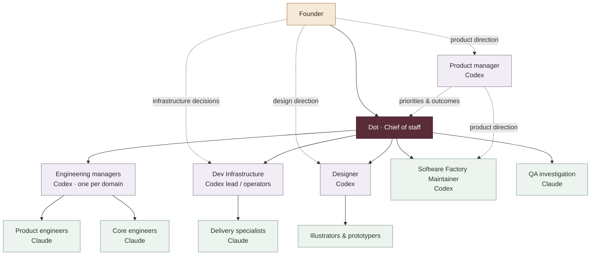

# Immortal Software Factory

**A founder, a chief of staff, and a team of persistent AI threads.**

The building blocks behind Immortal’s software development: who does what, how the threads connect, and where their shared context lives.

## At a glance

| Building block | Purpose |
| :--- | :--- |
| **Dot** | Chief of staff: coordinates execution and carries work through to completion. |
| **Codex threads** | Product planning, engineering management, design, infrastructure operations, and Software Factory maintenance. |
| **Claude threads** | Product and core engineering, specialist implementation, and QA. |
| **GrokBot** | Polling-based agent work; Dot currently communicates with it through Slack. |
| **Duet** | An exploratory coordination option that needs polling; a PR-ping wake-up workaround is being explored. |
| **Ephemeral Claude CLI thread** | Proposed backup relay from Dot to existing Claude threads. |
| **GitHub CLI (`gh`)** | Required tooling for managing our GitHub account and repositories. |
| **GitHub MCP plugin** | Companion GitHub integration used alongside the CLI. |
| **Notion** | Shared plans, specifications, decisions, and delivery records. |
| **GCP service account** | Scoped machine identity for authorized cloud operations. |
| **Slack** | For now, a channel for Dot to talk to GrokBot. |

## How the team connects

The founder sets direction. Dot coordinates execution. Domain leads organize the work; each agent owns its changes from implementation through merge.

Solid lines show coordination or team ownership. Dotted lines show direction and collaboration. The founder also works directly with product, design, and infrastructure. This is a reusable role map; individual threads and assignments change.

## The threads

### Dot — Chief of staff

Turns direction into assignments, starts ready work in parallel, follows up, resolves dependencies, and drives delivery. Brings the founder the decisions that need their judgment.

### Codex — planning, leadership, and operations

| Thread type | Responsibility |
| :--- | :--- |
| **Product manager** | Defines outcomes, priorities, and what completion means with the founder. Maintains the product plan. |
| **Engineering manager** | Coordinates a technical domain’s product and core engineers and resolves integration dependencies. |
| **Dev Infrastructure lead / operator** | Owns build environments, cloud operations, deployment, and operational verification. |
| **Designer** | Develops the experience with the founder and coordinates illustration and prototyping. |
| **Software Factory Maintainer** | Maintains this repository’s reusable building blocks, roles, and relationships, with PM direction and Chief coordination. |

### Claude — engineering and investigation

| Thread type | Responsibility |
| :--- | :--- |
| **Product engineer** | Implements user-facing features and interfaces. |
| **Core engineer** | Builds underlying capabilities, APIs, and platform behavior. |
| **Specialist engineer** | Owns a focused technical or delivery area, such as release machinery or signing. |
| **QA engineer** | Investigates and reproduces reported bugs with actionable evidence. Each author retains responsibility for reviewing, validating, and testing their own changes. |

Engineers collaborate directly on technical interfaces. Chief resolves cross-team dependencies; engineering managers coordinate within their domains.

Every agent is responsible and authorized to review, validate, test, push, and merge its own code. Each agent carries those steps through alone, without handing them to other agents. Coordination covers scope, interfaces, and dependencies; it does not add a separate agent review or testing gate. Explicit holds, such as an instruction not to merge a particular PR, still apply.

### GrokBot — experience so far

GrokBot needs polling in our current setup, and Dot communicates with it through Slack.

Our GrokBot trial consumed an entire week’s credits in 24 hours. Credit burn is a constraint on further experiments.

### Claude and Duet — communication experiments

Dot’s browser interaction with Claude has been flaky, so we are exploring other ways for Dot to reach Claude threads. Slack did not meet that need, and using Duet has been difficult.

A proposed backup is an ephemeral Claude CLI thread that talks to the existing Claude threads on Dot’s behalf. This is a relay for coordination; the existing agents still own their work end to end. This backup is still being explored.

Duet also needs polling in our current setup. Dot can ping a PR to wake Duet, making that wake-up path an interesting workaround to explore.

## Shared context and infrastructure

**Notion** holds durable context: plans, specifications, design references, decisions, and results. Threads use it to pick up work and pass it on.

**GitHub CLI (`gh`)** is necessary for managing our GitHub account and repositories. The GitHub MCP plugin is useful alongside it; the plugin alone does not replace the CLI.

**Slack**, for now, is only a channel for Dot to talk to GrokBot. It is not our general relay between Dot and Claude threads.

**The GCP service account** gives authorized automation a machine identity with scoped cloud permissions. It is an access mechanism, not a management role.

## Maintaining this repository

The Software Factory Maintainer keeps this public role map consistent as the factory evolves. PM owns product direction; Chief coordinates execution. Live assignments and delivery status stay in the team’s operational records.

See [Contributing](CONTRIBUTING.md) for scope, coordination, and documentation checks.

---

*An evolving description of our working software factory. We document role types and reusable relationships here; live assignments remain in the team’s operational records.*
