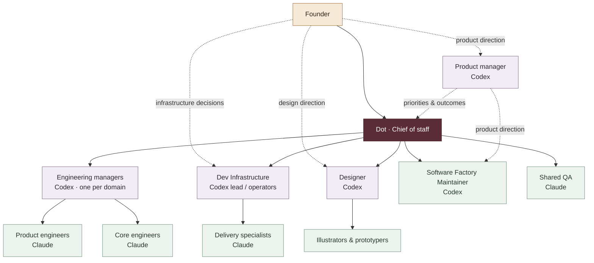

# Immortal Software Factory

**A founder, a chief of staff, and a team of persistent AI threads.**

The building blocks behind Immortal’s software development: who does what, how the threads connect, and where their shared context lives.

## At a glance

| Building block | Purpose |
| :--- | :--- |
| **Dot** | Chief of staff: coordinates execution and carries work through to completion. |
| **Codex threads** | Product planning, engineering management, design, infrastructure operations, and Software Factory maintenance. |
| **Claude threads** | Product and core engineering, specialist implementation, and QA. |
| **Grok bot** | Exploration. Its role is still being discovered. |
| **Notion** | Shared plans, specifications, decisions, and delivery records. |
| **GCP service account** | Scoped machine identity for authorized cloud operations. |
| **Slack** | Communication, questions, status updates, and handoffs. |

## How the team connects

The founder sets direction. Dot coordinates execution. Domain leads organize the work; engineers own implementation.

Solid lines show coordination or team ownership. Dotted lines show direction and collaboration. The founder also works directly with product, design, and infrastructure. This is a reusable role map; individual threads and assignments change.

## The threads

### Dot — Chief of staff

Turns direction into assignments, starts ready work in parallel, follows up, resolves dependencies, and drives delivery. Brings the founder the decisions that need their judgment.

### Codex — planning, leadership, and operations

| Thread type | Responsibility |
| :--- | :--- |
| **Product manager** | Defines outcomes, priorities, and what completion means with the founder. Maintains the product plan. |
| **Engineering manager** | Coordinates a technical domain’s product and core engineers and resolves integration dependencies. |
| **Dev Infrastructure lead / operator** | Owns build environments, cloud operations, deployment, and operational verification. |
| **Designer** | Develops the experience with the founder and coordinates illustration and prototyping. |
| **Software Factory Maintainer** | Maintains this repository’s reusable building blocks, roles, and relationships, with PM direction and Chief coordination. |

### Claude — engineering and investigation

| Thread type | Responsibility |
| :--- | :--- |
| **Product engineer** | Implements user-facing features and interfaces. |
| **Core engineer** | Builds underlying capabilities, APIs, and platform behavior. |
| **Specialist engineer** | Owns a focused technical or delivery area, such as release machinery or signing. |
| **QA engineer** | Finds and reproduces bugs with actionable evidence. Engineers retain responsibility for testing their own work. |

Engineers collaborate directly on technical interfaces. Chief resolves cross-team dependencies; engineering managers coordinate within their domains.

### Grok — exploration

Grok bot is available to experiment with. Its responsibility and place in the team are not yet defined.

## Shared context and infrastructure

**Notion** holds durable context: plans, specifications, design references, decisions, and results. Threads use it to pick up work and pass it on.

**Slack** carries conversations: coordination, questions, status updates, and handoffs.

**The GCP service account** gives authorized automation a machine identity with scoped cloud permissions. It is an access mechanism, not a management role.

## Maintaining this repository

The Software Factory Maintainer keeps this public role map consistent as the factory evolves. PM owns product direction; Chief coordinates execution. Live assignments and delivery status stay in the team’s operational records.

See [Contributing](CONTRIBUTING.md) for scope, coordination, and documentation checks.

---

*An evolving description of our working software factory. We document role types and reusable relationships here; live assignments remain in the team’s operational records.*
