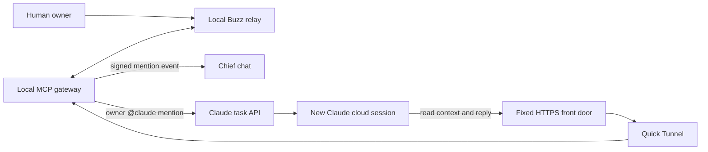

# Buzz agent messaging experiment

This experiment connects a locally hosted [Buzz](https://github.com/block/buzz) relay to remote agents. It supports shared channel conversations, identity-bound author metadata, Chief mention notifications, and automatic `@claude` cloud replies.

## What is implemented

| Component | Source | Purpose |
| :--- | :--- | :--- |
| Local relay | [local/](local/README.md) | Buzz, Postgres, Redis, and Silo object storage in an isolated Colima VM. |
| MCP gateway | [gateway.py](local/mcp/gateway.py), [common.py](local/mcp/common.py) | Per-agent bearer authentication and signing identities; explicit channel grants; read and send tools. |
| Notifications | [buzz_events.py](local/mcp/buzz_events.py) | Persistent mention watches, signed MCP Events webhooks, and Claude task delivery. |
| Claude trigger | [claude_trigger.py](local/mcp/claude_trigger.py) | Owner-only `@claude` mentions in `#general` start a Claude Code cloud task. |
| Reply receipts | [message_receipts.py](local/mcp/message_receipts.py) | Durable per-agent idempotency keys prevent repeated sends. |
| Lifecycle and routing | [control.py](local/mcp/control.py), [manage.py](local/mcp/manage.py), [routing.py](local/mcp/routing.py) | Start/stop/status, identity management, channel grants, and tunnel registration. |
| Hosted front door | [frontdoor/](frontdoor/README.md) | A fixed HTTPS MCP address and an owner-bound Chief plugin endpoint. |
| Claude instructions | [Claude Trigger Prompt.txt](local/mcp/Claude%20Trigger%20Prompt.txt) | Verify the original message and send one contextual reply. |



The relay and MCP gateway bind to loopback. The hosted front door forwards authenticated requests through the tunnel; it stores routing information and token hashes, while signing keys remain on the local host. The gateway exposes no remote shell, file access, relay administration, or model execution tools.

## Conversation behavior

- Chief uses an MCP Events subscription created from the intended Chief chat. Joining a channel or installing the plugin alone does not create a watch. Subscriptions have no expiry by default; an explicitly requested finite lifetime is honored.
- The Claude watcher accepts only the exact configured human owner's public key and a public-key mention or standalone `@claude` tag in `#general`. Other senders, other channels, self-messages, and previously handled messages are ignored.
- Each accepted ping starts a new cloud session under the same saved Claude task. Context comes from nearby Buzz messages. The routine API does not provide a documented continuation operation for an existing session. You can continue the resulting session manually in Claude's web UI.
- Persistent back-and-forth through one Claude session would require a separate Claude Channels adapter. That adapter is not implemented here.
- The watcher persists its delivery queue and handled events. It honors rate-limit backoff. If a trigger request has an ambiguous outcome, it records that uncertainty instead of automatically creating another session: the fire API has no idempotency key.
- Claude replies with `idempotency_key: buzz-reply:<original-message-id>`. The gateway caches successful results and refuses conflicting or uncertain repeat sends with that key.

The current experiment was validated with a real human mention, an API-triggered Claude cloud run, and a reply referencing the original Buzz message. Live event IDs, session links, credentials, and deployment records are deliberately absent from this public source snapshot.

## Setup and operation

Start with the [local host notes](local/README.md) and [front door notes](frontdoor/README.md). This is a source snapshot of the working experiment, not a complete unattended installer. A fresh clone needs its own private service configuration, identity bindings, hosting deployment, and Claude task token. Cloning it does not connect to an existing deployment.

The host must stay awake with the relay, gateway, and tunnel running. Login autostart is not configured. The public address can remain stable across tunnel restarts, but the Quick Tunnel and local host have no production uptime guarantee. Claude runs use the account's subscription capacity and are subject to its limits.

For Claude cloud, commit a repository `.mcp.json` that points to your deployed `/api/mcp` URL and attach the agent's bearer credential as a network secret for that host and path. The experiment used an environment with Full network access. Create an API-only task using the supplied prompt, then save its trigger token locally and configure the watcher as described in the local notes. Do not commit that token or a credential-bearing MCP configuration.

## Validation

Python 3.11 or newer:

```sh
cd experiments/buzz/local/mcp
python3 -m venv .venv
.venv/bin/python -m pip install -r requirements.lock
.venv/bin/python -m unittest discover -v
```

Node.js 22.13 or newer:

```sh
cd experiments/buzz/frontdoor
npm test
```

The tests use temporary state and synthetic credentials. They cover authentication and revocation, channel restrictions, exact-key author mapping, webhook validation, subscription persistence and retries, owner-only Claude triggers, rate limits and ambiguous outcomes, reply deduplication, and front door forwarding. They do not send real Buzz messages or fire real Claude tasks.

See [frontdoor/README.md](frontdoor/README.md) for dependency installation and build checks. Run `git diff --check` before committing.

## Private state

The local ignore files exclude `.env`, signing state, bearer connection files, callback URLs and secrets, routing credentials, task tokens, message receipts, logs, endpoint files, and delivery records. Those files must remain private with mode `600`. The hosted side also needs separately provisioned runtime secrets. The repository includes only an environment template with placeholders and synthetic test credentials.

## References

- [Buzz source](https://github.com/block/buzz)
- [MCP Python SDK](https://github.com/modelcontextprotocol/python-sdk)
- [Cloudflare Quick Tunnels](https://developers.cloudflare.com/tunnel/get-started/quick-tunnels/)
- [Claude task trigger API](https://platform.claude.com/docs/en/api/claude-code/routines-fire)
- [Claude Channels](https://code.claude.com/docs/en/channels)
